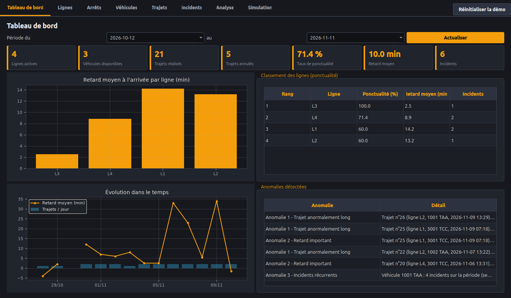
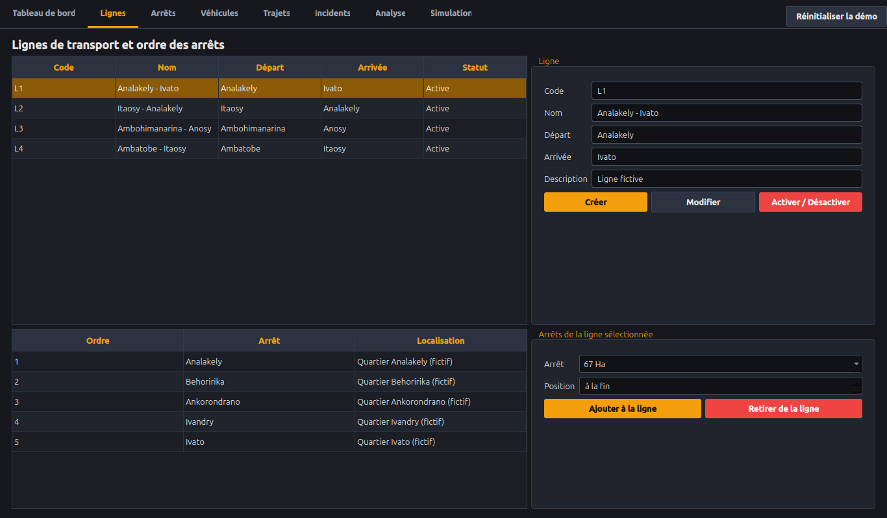
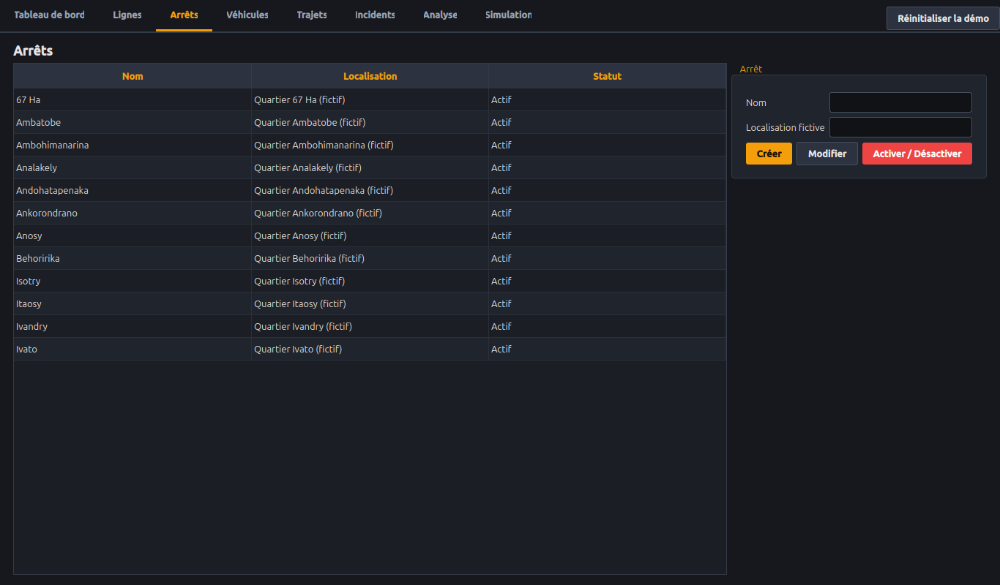
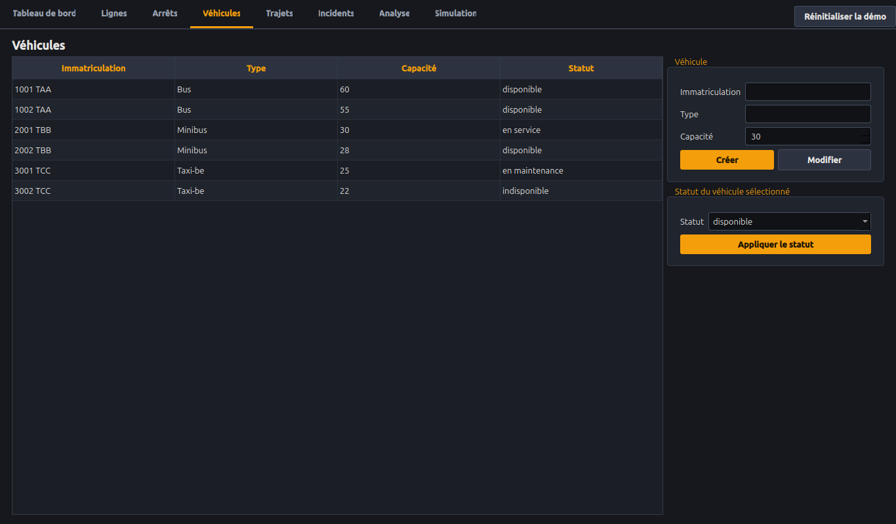
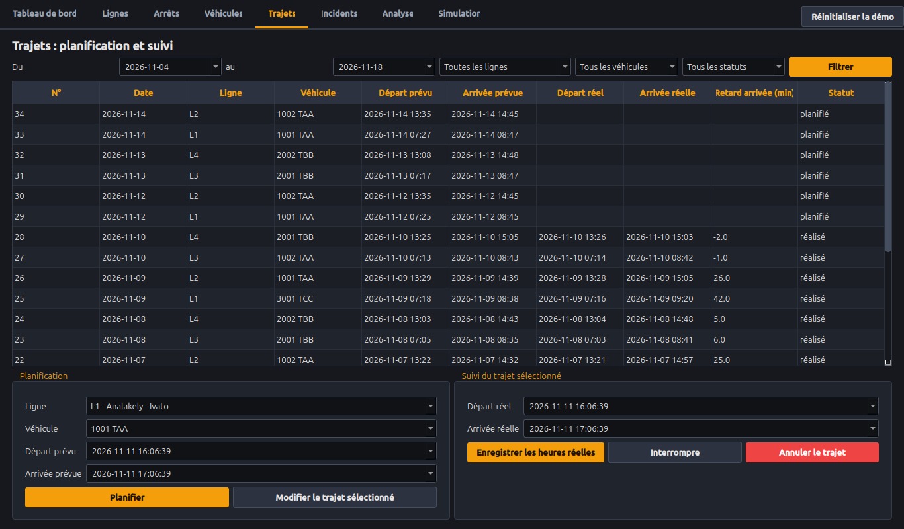
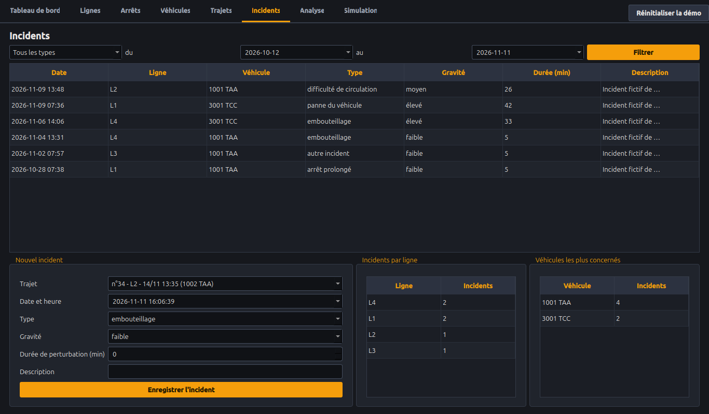
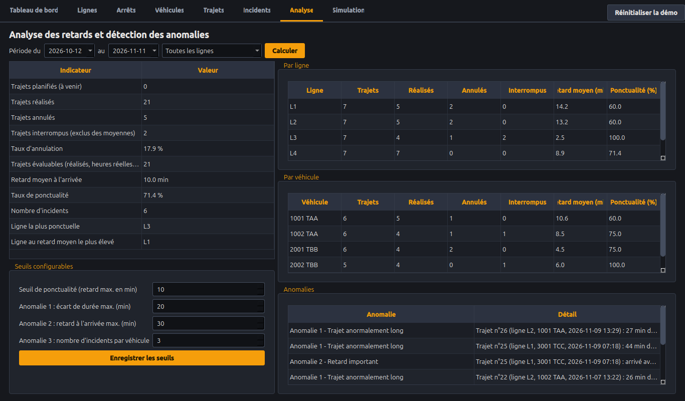
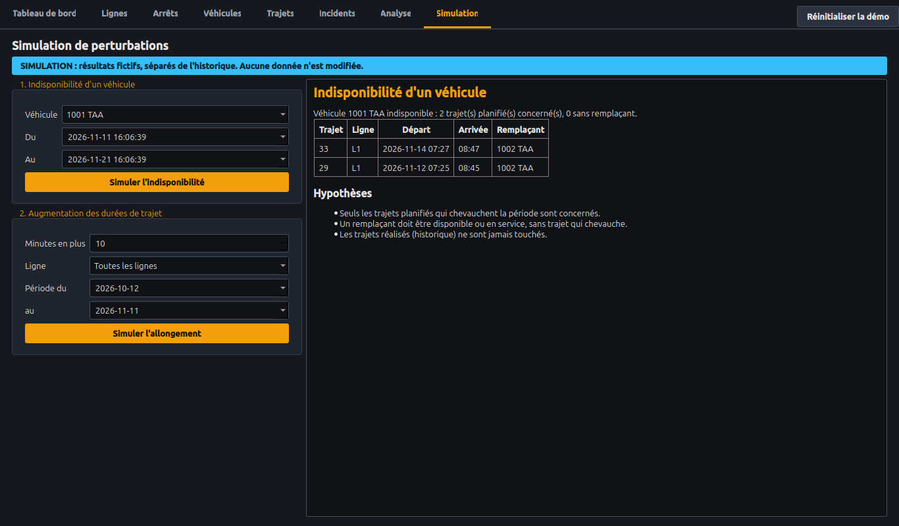

# Analyse et gestion des transports urbains

Application desktop Python (PyQt5 + MySQL + Matplotlib), architecture MVC. **Données 100 % fictives** (réseau imaginaire).
Interface volontairement différente du projet hôpital : thème sombre ambre, navigation par **onglets** en haut.

## Lancer

```bash
pip install -r requirements.txt          # PyQt5, matplotlib, mysql-connector-python
# MySQL doit tourner. Réglages dans config.py ou variables d'environnement :
# DB_HOST, DB_PORT, DB_USER, DB_PASSWORD, DB_NAME (défaut : transport_urbain, créée automatiquement)
python main.py                           # au 1er lancement, la démo est chargée automatiquement
python -m unittest -v                    # tests (base séparée transport_test)
```
Le bouton **Réinitialiser la démo** (en haut à droite) recharge le jeu de données.

## Captures d'écran










## Architecture MVC : qui fait quoi ?

| Dossier | Rôle | Fichiers |
|---|---|---|
| `model/` | Accès MySQL, règles métier, calculs, anomalies, simulation. **Aucun import PyQt.** | `db.py` · `lignes.py` (lignes + arrêts) · `vehicules.py` · `trajets.py` · `incidents.py` · `analyse.py` · `anomalies.py` · `simulation.py` · `parametres.py` · `donnees_demo.py` · `modele.py` (façade) |
| `view/` | Onglets, formulaires, tableaux, graphiques. **Aucune requête SQL, aucun calcul métier.** | `fenetre.py` · `pages_gestion.py` · `pages_analyse.py` · `widgets.py` · `style.py` (couleurs) |
| `controller/` | Reçoit les clics, valide les saisies, appelle le modèle, rafraîchit la vue, gère les erreurs. | `controleur.py` |

Flux d'une action : clic → `Controleur.xxx()` → `executer()` → méthode du modèle → (`ErreurMetier` ? message) → `rafraichir()`.

### Je veux modifier… → j'ouvre…
- une **règle de planification** (chevauchement, véhicule indisponible…) : `Trajets._verifier_affectation()` dans `model/trajets.py` ;
- une **formule de retard / ponctualité** : `metriques()` et `statistiques()` dans `model/analyse.py` ;
- une **règle d'anomalie** ou un seuil par défaut : `model/anomalies.py` et `schema.sql` (table `parametres`) ;
- une **simulation** : `model/simulation.py` ;
- les **couleurs** : `view/style.py` ; un **champ de formulaire** : `view/pages_*.py` (+ le contrôleur) ;
- les **données de démo** : constantes en haut de `model/donnees_demo.py`.

## Base de données (`schema.sql`)
Tables : `lignes`, `arrets`, `ligne_arrets` (ordre de passage), `vehicules`, `trajets`, `incidents` (cahier des charges) + `parametres` (ajoutée : seuils configurables).
- **Date du trajet** : colonne calculée `date_trajet = DATE(depart_prevu)` ; les 4 horaires sont des `DATETIME` (pas de trajet > 24 h, vérifié dans le code).
- Clés primaires/étrangères, `UNIQUE` (code de ligne, immatriculation, nom d'arrêt, `(id_ligne, ordre)`), `CHECK` (capacité > 0, statuts, gravité…).
- Requêtes **paramétrées** ; chaque opération à plusieurs écritures = **transaction** (`with db.transaction():`), le véhicule est verrouillé (`FOR UPDATE`) pendant la vérification de chevauchement.
- Aucune suppression physique : lignes/arrêts/véhicules se désactivent, les trajets passés restent.

## Conventions de calcul (documentées dans `model/analyse.py`)
- Écarts en **minutes** ; positif = retard, négatif = avance. Retard départ, retard arrivée, durée réelle, écart de durée : formules du cahier des charges.
- Trajet **évaluable** = « réalisé » avec heures réelles valides. Annulés, interrompus et incomplets sont **exclus** des moyennes et de la ponctualité, mais comptés à part.
- Ponctualité = trajets avec retard arrivée ≤ seuil (10 min, configurable) / évaluables × 100. Aucun évaluable → **« Non calculable »**.
- Taux d'annulation = annulés / tous les trajets de la période.

## Anomalies (onglets Tableau de bord et Analyse)
1 Trajet anormalement long (écart de durée > 20 min) · 2 Retard important (> 30 min) · 3 Incidents récurrents (≥ 3 par véhicule sur la période) — seuils modifiables dans l'onglet Analyse, justification dans `model/anomalies.py`.
4 Conflit d'affectation et 5 Incohérence temporelle : **refus** à la planification, avec message explicatif.

## Simulation (lecture seule, onglet Simulation)
1. *Indisponibilité d'un véhicule* : liste les trajets planifiés touchés par la période et propose un véhicule de remplacement libre (ou « aucun »). 2. *Allongement des durées* : +N minutes sur tous les trajets réalisés d'une période, comparaison historique / simulé. Hypothèses affichées ; aucune écriture en base (test `test_simulation_sans_modification`).

## Jeu de données de démonstration
4 lignes · 12 arrêts · 6 véhicules (dont 1 en maintenance, 1 indisponible) · 34 trajets (21 réalisés, 5 annulés, 2 interrompus, 6 planifiés) · 6 incidents · 3 tentatives invalides refusées (conflit, véhicule en maintenance, arrivée avant départ). Le véhicule `1001 TAA` a 4 incidents (anomalie 3).

## Tests (`tests/test_transport.py`, 22 tests, tous réussis)
| Test du cahier des charges | Résultat attendu | Obtenu |
|---|---|---|
| Création d'une ligne avec un code unique | Création réussie | ✅ `test_ligne_code_unique` |
| Deux lignes, même code | 2ᵉ création refusée | ✅ `test_deux_lignes_meme_code` |
| Enregistrement d'un trajet valide | Enregistrement réussi | ✅ `test_trajet_valide` |
| Véhicule indisponible | Opération refusée | ✅ `test_vehicule_indisponible` |
| Deux trajets qui se chevauchent (même véhicule) | Conflit détecté | ✅ `test_chevauchement_meme_vehicule` |
| Arrivée prévue avant le départ prévu | Enregistrement refusé | ✅ `test_arrivee_avant_depart` |
| Trajet réalisé, horaires réels valides | Retards correctement calculés | ✅ `test_retards_calcules` |
| Trajet annulé | Exclu de la ponctualité | ✅ `test_annule_et_interrompu_exclus_de_la_ponctualite` |
| Retard supérieur au seuil | Alerte générée | ✅ `test_retard_superieur_au_seuil` |
| 3 incidents ou plus sur un véhicule | Récurrence détectée | ✅ `test_trois_incidents_sur_un_vehicule` |
| Base sans trajet | Statistiques sans erreur | ✅ `test_base_sans_trajet` |
| Simulation d'indisponibilité | Aucune modification de l'historique | ✅ `test_simulation_sans_modification` |

Tests en plus : départ ≠ arrivée, capacité/immatriculation, ordre des arrêts, ligne désactivée, trajet planifié seul modifiable, seuil de ponctualité configurable, simulations (remplaçant, sans remplaçant, allongement).

## Déclaration d'usage de l'IA (à relire et compléter par l'étudiant)
- **Outil** : assistant de programmation Claude Code (Anthropic).
- **Tâches concernées** : conception du schéma MySQL, génération de tout le code Python (modèle, vue, contrôleur), des tests et de ce document.
- **Suggestions retenues** : transactions + verrouillage du véhicule ; colonne calculée `date_trajet` ; calcul des statistiques en Python à partir de `metriques()` (une seule formule pour tout) ; seuils dans une table `parametres` ; simulation en lecture seule.
- **Vérifications réalisées** : 22 tests automatiques passés sur MySQL 8.4 ; lancement de l'interface et parcours des 8 onglets ; relecture statique (pyflakes). **À faire par l'étudiant** : relire chaque module, rejouer tests et démo, être capable d'expliquer et de modifier `trajets.py`, `analyse.py` et `anomalies.py`.
